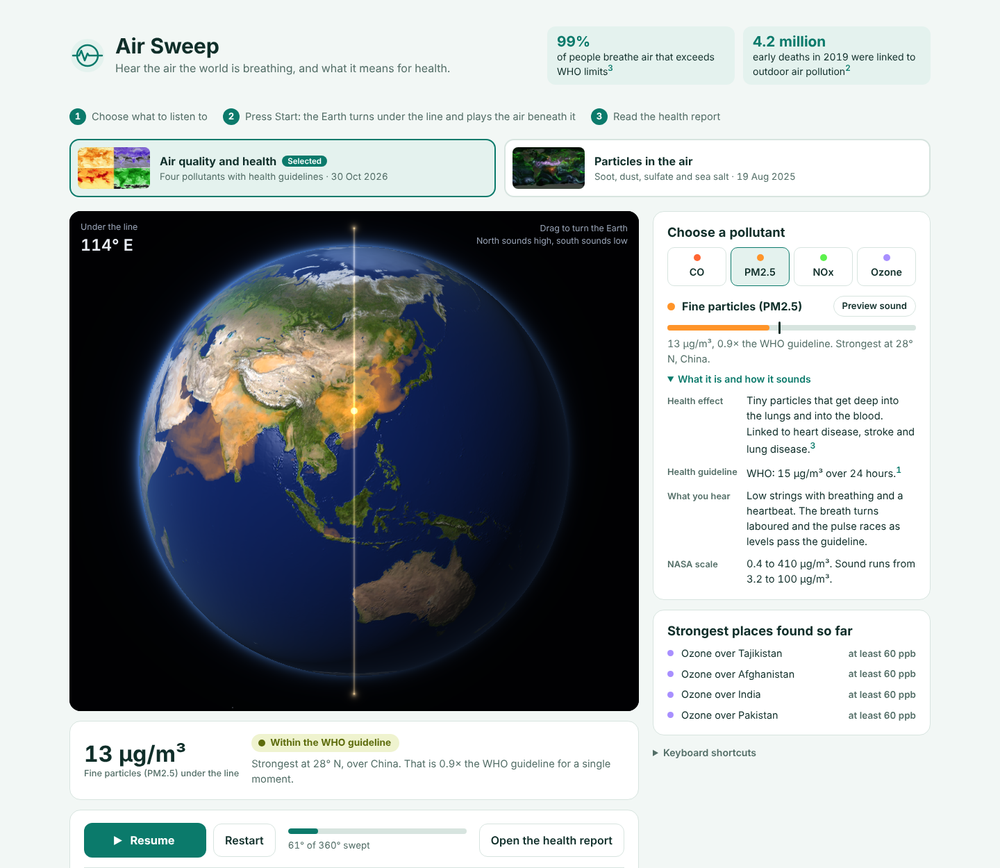

# Air Sweep

**Hear the air the world is breathing, and what it means for health.**

Air Sweep is an entry for the NASA Space Apps Challenge "Earth Information Jukebox". It turns NASA Earth Information Center visualizations of air pollution into sound, so that people who are blind or have low vision, and everyone else, can explore them by ear.



## How it works

A 3D Earth turns beneath a fixed line that runs from pole to pole. The line works like the needle of a record player: whatever air lies under it is what you hear.

- **Latitude is pitch.** North sounds high, south sounds low.
- **Hotspots are notes.** The strongest places on the line (up to three per layer) play as separate notes.
- **Each pollutant has its own instrument**, shaped by what it does to the body:

| Pollutant | Sound | Why |
|---|---|---|
| Fine particles (PM2.5) | Low strings with breathing and a heartbeat that quicken | Reaches deep into the lungs and the blood |
| Ozone | A whistle that trembles and catches | Closely linked to asthma |
| Nitrogen oxides | An engine that idles, revs and puffs | Comes from traffic, power plants and industry |
| Carbon monoxide | A slow drone that sags | Stops the blood carrying oxygen well |

- **A signal sounds** when the line crosses a WHO health guideline.
- **A health report** ranks countries, labels each against the WHO guideline, and replays the sound of each place.

There are two views:

1. **Air quality and health**: near-surface PM2.5, ozone, nitrogen oxides and carbon monoxide.
2. **Particles in the air**: soot, dust, sulfate and sea salt, separated by colour from NASA's aerosol visualization.

## Accessibility

- Everything works from the keyboard: `Space` start or pause, `←` `→` turn the Earth, `1`–`4` choose a pollutant or layer, `R` open the report.
- Screen readers get spoken updates while the sweep plays, and the globe is exposed as a slider.
- Health status never relies on colour alone: every label has text and a shape.
- Light and dark themes, and reduced-motion support.

## Run it

Open the hosted page (see the link in this repository's "About" box), or run it locally:

```
python3 -m http.server 8000
```

then open `http://localhost:8000`. Opening `index.html` directly from disk does not work, because browsers block WebGL textures loaded from `file://`.

## From NASA picture to numbers

The app does not download live data. It reads still frames from NASA visualizations:

1. Each frame is aligned to a latitude/longitude grid using Natural Earth coastlines.
2. For air quality, every pixel colour is matched to NASA's own colour bar to recover a value in real units (ppb or µg/m³).
3. Thin lines that NASA draws for borders and lakes are detected and filled in, so they are not read as pollution.
4. For aerosols, the mixed colours are separated into NASA's four legend hues. These layers have no units, so they are shown as relative levels only.
5. Each country is scored by its strongest area, smoothed over roughly 150 km.

To reproduce:

```
pip install numpy scipy pillow
python3 prep/build_data.py     # about one minute; writes assets/ and prep/out/meta.json
python3 src/build.py           # writes index.html
```

## What is in this repository

| Path | What it is |
|---|---|
| `index.html` | The finished app (built file) |
| `assets/` | Earth textures and the processed NASA layers |
| `src/index.template.html` | The app source: HTML, CSS, WebGL shader and Web Audio engine |
| `src/build.py` | Inserts the place statistics into the template |
| `prep/build_data.py`, `prep/geo.py` | Turn the NASA frames into layers and statistics |
| `prep/input/` | The NASA frames and colour bars used |
| `prep/naturalearth/` | Coastlines, borders and place names |
| `prep/out/meta.json` | Place statistics and scale definitions |

## Limits you should know

- Values are **single-moment model values** read from colour, not measurements, and **not medical advice**.
- WHO guidelines are for 8- or 24-hour averages; comparing them with one moment is rough.
- The nitrogen comparison uses the WHO guideline for nitrogen dioxide alone, while NASA's map shows nitrogen oxides.
- Conversions between ppb and µg/m³ assume 25 °C.
- Ozone at the top of NASA's colour bar can only be reported as "at least 60 ppb".
- Smoothing softens small, intense sources, so country counts are on the low side.
- The four status labels (cut at 0.5×, 1× and 2× the WHO guideline) are this project's own, not an official index.
- The Earth surface is a cloud-free composite, not the weather on the day of the data.

## Tools

JavaScript, HTML and CSS with no frameworks. WebGL (custom fragment shader) for the globe. Web Audio API for all sound, synthesized live in the browser. Python with NumPy, SciPy and Pillow for data preparation.

## Use of AI

This project was built with **Claude**, an AI model made by Anthropic, directed by mjt.

- **AI-generated:** the application code, the sound design (all sound is synthesized live by that code; no AI audio generator was used), the data-processing scripts, the text in the app, the logo icon and this README.
- **Not AI-generated:** the air data and maps (NASA), the Earth surface image (Solar System Scope), borders and place names (Natural Earth), and the health guidance (WHO, US EPA).

No AI image or video generator was used. No NASA logos, flags or mission identifiers appear in the project.

## Data and credits

- **NASA Scientific Visualization Studio and NASA GMAO**: [PM2.5](https://svs.gsfc.nasa.gov/5151/), [ozone](https://svs.gsfc.nasa.gov/5152/), [carbon monoxide](https://svs.gsfc.nasa.gov/5153/), [nitrogen oxides](https://svs.gsfc.nasa.gov/5154/), [aerosols](https://svs.gsfc.nasa.gov/5669/).
- **Earth surface texture**: [Solar System Scope](https://www.solarsystemscope.com/textures/), CC BY 4.0. `assets/earth_surf.jpg` is a relief and land/ocean helper map prepared for this project.
- **Borders, coastlines and place names**: [Natural Earth](https://www.naturalearthdata.com/), public domain.

## Health sources

1. World Health Organization. [WHO global air quality guidelines (2021), recommendations](https://www.ncbi.nlm.nih.gov/books/NBK574591/).
2. World Health Organization. [Ambient (outdoor) air pollution fact sheet](https://www.who.int/news-room/fact-sheets/detail/ambient-(outdoor)-air-quality-and-health).
3. World Health Organization, April 2022 air quality database update, as reported by [CBS News](https://www.cbsnews.com/amp/news/air-quality-who-report-poor-quality-air).
4. World Health Organization. [Types of pollutants](https://www.who.int/teams/environment-climate-change-and-health/air-quality-and-health/health-impacts/types-of-pollutants).
5. US Environmental Protection Agency. [Air Quality Index basics](https://www.airnow.gov/aqi/aqi-basics/).
6. US Environmental Protection Agency. [Air quality guide for particle pollution](https://www.airnow.gov/sites/default/files/2021-03/air-quality-guide_pm_2015_0.pdf).
7. UK Department for Environment, Food and Rural Affairs. [Conversion factors between ppb and µg/m³](https://uk-air.defra.gov.uk/reports/cat06/0502160851_Conversion_Factors_Between_ppb_and.pdf).
8. NHS England. [Standard for creating health content](https://service-manual.nhs.uk/content/standard-for-creating-health-content).
